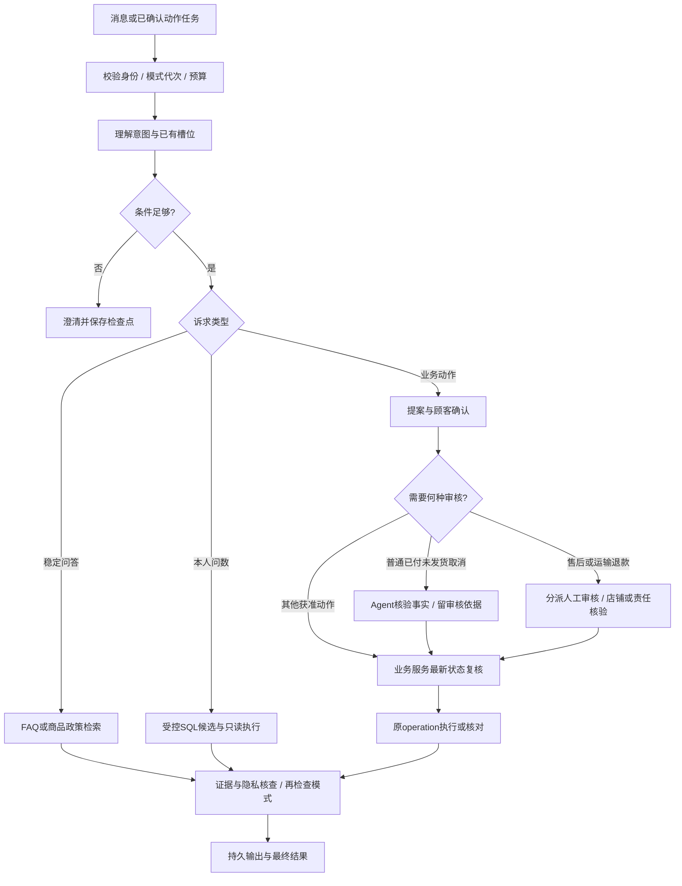

# Agent、检索与模型接口设计

版本：AGENT-CS-v0.1，2026-10-22；依据REQ-CS-v0.2。本项目流程设计已随DESIGN-CS-v0.1获批，预算作为调优初值，不能降低需求指标。客服对话、SQL生成、Embedding和重排分责，所有模型服务当前均未接入或实测。

## 1. 角色、状态与工具面

客服对话模型负责理解/澄清、选择获准工具、整合证据与答复；整个Agent由模型、LangGraph流程、权限门面、业务服务、持久任务、检查点和人工协同组成。SQL模型只生成候选，Embedding生成向量，重排只排序。模型的“通过”或工具调用格式不构成业务权限。

图状态建议包含：run/context_kind、conversation_id（会话型必填）、action_operation_id（订单页审核型必填）、可信主体/会话引用、intent_slots、当前最多3个子任务、选中资源引用、证据ID/版本、pending_confirmation_ref、mode_epoch、授权/图/模型版本和任务栅栏。完整Cookie、密钥、电话和详细地址不入状态。主体引用来自服务端，恢复不能反序列化用户提供的state覆盖它。

| 工具族 | 允许输入与输出 | 服务端限制 |
| --- | --- | --- |
| public_catalog / policy_retrieve | 商品/SKU/主题、适用日期、上限→公开事实/来源片段 | 商品主题识别不决定身份；当前价格/库存走业务服务 |
| own_business_query / sql_candidate | 去身份化诉求、已核验槽位→SQL候选或获准结果 | 本人/字段/只读约束独立于Prompt和WHERE；员工工作台不因此获得自由SQL |
| action_propose / operation_status | 白名单动作/资源/安全引用→确认卡片/原结果 | 模型不能自填confirmed=true；完整地址用本人表单引用 |
| action_execute | 已有确认/operation、当前run栅栏→原业务结果 | 可信主体/确认有效/状态/量额/模式再次复核；同operation重跑不新写 |
| ticket / handoff | 明确诉求与脱敏摘要→工单/queued状态 | 未接通不说已接通，进入queued暂停Agent |
| experience_retrieve | 主题/条件/获准范围→已审案例或Skill版本 | 只参考适用经验并重新查当前事实，不授予售后审批权或扩大工具白名单 |

每次工具调用先经过统一授权、输入类型校验、预算及脱敏，再进入模块应用服务。工具不可接收任意URL、数据库连接、任意SQL写入或Python执行代码。用户、检索资料、案例和模型输出都不能改变这条调用链。

## 2. 流程、中断与业务审核



多轮只保存已明确槽位及其来源；用户改变日期/SKU/订单时撤销受影响的旧结果/提案。本人候选多单先展示获准选项，不猜“那单”。连续3轮仍不清楚提供工单/人工，不重复问已有信息。多意图分别有完成/失败/待澄清状态，读取成功不隐式确认写入。

Agent取消资格审核必须真实参与流程并留下事实引用、检查项、结论/摘要、规则/模型/Skill版本及确认/执行关联。建议先由确定性规则计算owner、paid/unshipped、可退额及确认约束，再由客服对话模型依据这些事实形成结构化审核；模型拒绝/不确定则不执行，通过也不豁免业务服务复核。审核摘要不保存隐藏思维链。人工补事实后重新审核，不能用人工通过替代要求的Agent审核。

检查点在澄清、待确认、中断/阶段边界保存进度；恢复使用可信thread/run映射、图版本和PostgreSQL检查点，不把客户端传入thread_id当权限。会话run与订单页action审核run区分，后者无需顾客聊天但同样有主体/有效会话、确认和业务结果。检查点落后时先查原operation，不重新创建资金意图。

LangGraph的中断恢复可能重跑节点，因此确认等待与业务副作用分离；最终副作用即使在单独节点仍必须依赖业务幂等/唯一约束，不能推断“分节点后只会执行一次”。[中断与重执行说明](https://docs.langchain.com/oss/python/langgraph/interrupts)、[持久化说明](https://docs.langchain.com/oss/python/langgraph/persistence)

queued/human期间旧run暂停新输出/业务动作；模式代次、任务租约或身份失效时拒绝提交。人工结束只恢复Agent接收新诉求，旧确认不自动运行。用户取消run与断流分开，已提交付款/退款不可因run取消被抹去。

## 3. 最小知识链路、FAQ与经验治理

### 3.1 准备与召回

本工程受控文本维护→来源/规则/范围/有效期校验→按标题/条款切分→中文词元＋BGE-M3稠密向量→版本索引→审核发布。只处理商品/政策文本及已批准FAQ/经验，完整批量/多格式/OCR平台和旧RAG重构不纳入。初始切分建议每段约500～900中文字、重叠约80字，以条款完整和模型长度限制修正，参数版本化。

中文词法建议jieba搜索分词＋受控SKU/商品名/政策术语词典，查询/文档使用同一规范化版本；词元交由PostgreSQL简单词典检索并保留来源，不假定默认全文解析能完成中文业务分词。未知别名先澄清，不让分词替代商品识别。[jieba官方项目](https://github.com/fxsjy/jieba)、[PostgreSQL解析器](https://www.postgresql.org/docs/current/textsearch-parsers.html)

在线先识别商品/主题、核验公开或获准可见范围及适用日期，再分别词法/向量召回。初值建议各取20、合并去重最多40，用RRF融合（每路贡献1/(60+排名)，同分按稳定ID），取最多10条交Qwen重排，最终最多5条/总约6000中文字进入证据上下文。每阶段先后都核对源状态和适用范围，不能先把内部/停用内容发给重排服务后再过滤。

参考200片段规模建议先用获准集合的精确向量检索；不默认引入HNSW/IVFFlat及其召回调参。pgvector支持精确与近似检索，近似索引的过滤/召回行为需要另测；这只支持候选方案，不能据此宣称本项目Recall@5已达标。[pgvector说明](https://github.com/pgvector/pgvector)

历史订单政策先通过本人业务服务取得订单保存的适用版本/快照；不直接套当前政策。该版本的历史适用性与当前公开检索有效性分开核对，仍须有可读取的可信来源；来源撤销/缺失/冲突则needs_review，由人工核验，不因历史引用就绕过撤权或编造规则。

### 3.2 重排、答案和降级

沿用Qwen3-Reranker-0.6B；输入query及获准候选ID/文本，输出只能是输入ID子集及顺序/分数/score_type/服务修订。不接受未知或重复ID，不把分数默认为概率/正确率，不用模型返文替换原引用。重排服务超时/协议错时按基线回退同一获准混合召回序并标degraded，源有效性再检，不伪称已完成重排。

答案按来源片段陈述，附unit/revision/chunk/条款位置及适用时间，引用打开同等鉴权。资料不足、矛盾、过期、无关、超时分别表达；不能先流出未核实事实再在结尾更正。动态价格/库存/订单/物流/余额来自业务查询，混合答案分别标来源。无权内容不向顾客显示其标题或存在性。

### 3.3 FAQ、案例和Skill

FAQ先作稳定意图/同义表达的受控匹配，核对条目已审核发布、来源版本/商品范围/有效期。只有稳定问答可复用，当前余额/物流/订单状态及不明确商品期限不得硬命中。来源停用或版本变化使旧答案复用失效；无可用FAQ回退澄清/RAG/业务查询，不返回旧缓存。缓存不要求Redis，首先基于版本记录与应用受控读面。

FAQ数据沿用PRD7.4的FAQ-SIM-v0.2、14条合成问答；目标14标准问法全部正确复用、28同义至少26正确复用、至少12负例无错误复用，回退不冒充命中；数据目前draft，审核/发布时间不伪造。

已处理人工工单→脱敏案例候选（名称/分类、前置/排除、核验、步骤、结果）→主管审核→适用检索。主管发起或Agent推荐归纳Skill候选→主管审核＋独立回归→发布，可停用/回退。案例检索区分内部处置内容与顾客可见说明，不把整份内部Skill回传顾客。Skill定义允许步骤/工具/确认/转人工点，最终权限仍由服务端判断，不自动学习成新退款权或代码。

新版本先准备完整词元/向量，再切发布指针，60秒内可观察；源撤销在下次读取前生效，不等缓存TTL。Embedding修订/维度变更必须建完整新索引，不能静默混用。所有治理、异常和降级轨迹使用版本化脱敏数据。

## 4. 受控Text-to-SQL链路

自然语言本人问数→解析/澄清时间及资源条件→检索获准Schema/指标→调用SQL API→解析结构候选→校验AST/参数/资源/预算→独立授权与只读执行→脱敏结果解释。固定订单详情、最新库存和写前状态复核可直接业务接口，不强迫每个读取生成SQL。

模型面逻辑资源初稿如下，字段定义沿用数据字典和CS-QUERY-v0.1版本，不是已建视图；任何未登记字段/关联默认拒绝。私有资源均由数据库本人/本店策略独立限制，即使模型遗漏过滤也不能出界。

| 逻辑资源/粒度 | 可查询字段类别 | 口径约束 |
| --- | --- | --- |
| cs_product_public：一SKU | product_id/sku_id、名称/规格/类目、公开可售状态/单价/CNY、available_qty、price_version/as_of | 公开事实，不含内部成本；查询数量不等于预留 |
| cs_order_self：一订单 | order_id、创建/付款/本人收货时间、trade_status/fulfillment_status、商品原额/优惠/原运费/应付/原实付/成功已退/净实付minor、currency | 本人，订单金额只在订单粒度求和；无完整收货字段 |
| cs_order_item_self：一快照行 | order_item_id/order_id/sku_id、名称规格/单价、原数量/商品实付、成功已退量额/有效占用/剩余可退 | 行商品实付不含重复订单运费；关联只允许到本人订单及登记SKU |
| cs_shipment_self：一包裹 | shipment_id/order_id、承运状态、发货/承运签收/本人确认引用、最后更新时间 | 签收与本人收货不同，V1整单包裹 |
| cs_logistics_event_self：一轨迹 | event_id/shipment_id、状态类别、脱敏地点摘要、发生/记录时间 | 一包裹多轨迹，不能连接后重复算订单金额；无顾客详细地址 |
| cs_aftersale_self：一申请 | aftersale_id/order_id、类型/状态/原因类别、申请/审核/收退时间、商品/运费申请及成功退款minor | 正式售后与运输异常分型，申请不等于到账 |
| cs_transport_incident_self：一异常工单 | incident_id/order_id/shipment_id、类别/核验状态、核验/退款时间、已核验金额 | 不暴露内部备注/处理人员私有信息，缺核验不推断退款 |
| cs_wallet_summary_self / cs_wallet_entry_self：一账户/一流水 | balance_minor/currency/账户状态；ledger_id、类型/方向/金额/前后余额、发生时间 | 只本人，账户快照与资金流水不同粒度；不开放员工全店余额统计 |

关联目录只允许已登记的order_id、order_item_id、shipment_id和sku_id连接；聚合跨粒度必须先在正确粒度预聚合并由固定标准结果检验，不能让SQL执行成功代替口径正确。订单行/轨迹连接导致重复总额也计语义错误。

| 防线 | 本设计要求 | 验证重点 |
| --- | --- | --- |
| 可信范围 | 本人/店铺上下文来自服务端；问题中的姓名/手机号不能换身份；订单号先转已授权资源令牌 | 两顾客相同问题、删掉模型WHERE、子查询及聚合均不能读他人 |
| Schema面 | 仅公开商品及本人订单/明细/包裹/售后/余额脱敏逻辑视图与允许字段/关联/口径 | 不给完整电话地址、内部成本、凭据、原始聊天或跨店资源；未知版本拒绝 |
| AST | SQLGlot按PostgreSQL解析所有语句，仅一个只读查询；递归检查CTE/子查询/集合/表达式及作用域 | 禁DML/DDL/多语句、写CTE、SELECT INTO、锁定子句、系统目录、任意表函数/危险函数/未解析节点；不是正则筛关键字 |
| 字段/函数 | 解析别名、CTE来源与列权限；显式返回字段，count(*)作为受控聚合单列审查，禁止任意SELECT * | 函数按任务白名单，如受控count/sum/min/max/avg/coalesce/date_trunc，参数类型/日期粒度同样校验；拒绝set_config等修改上下文 |
| 绑定 | 日期、SKU/订单令牌等由后端解析绑定，模型只用预声明参数名 | 不拼接客户端值，禁止候选引入未声明参数/身份参数；资源令牌解析失败无权同样不可访问 |
| 数据库 | 非owner/非superuser/无BYPASSRLS只读角色；事务本地可信上下文、RLS及受控视图；仅允许所需字段 | 验证视图调用者语义、缺上下文默认拒绝、连接回池及并发串号；只读事务不代替字段权限 |
| 资源 | 默认近30日、最大366日、默认20条/最多50行、DB执行2秒；AST大小/关联层数及计划成本需有上限 | 建议AST文本≤8KiB、关联≤3、CTE≤2、表达式深度≤8作为待测初值；计划成本阈值须按固定数据测量，未配置不开放候选执行 |
| 计划/结果 | AST允许后才做有预算的EXPLAIN，不使用ANALYZE；返回行/列和字段类型再审 | EXPLAIN成本不是毫秒/安全证明；计划和实际超时分别记，结果再次脱敏；错误不回显敏感SQL/库结构 |

SQLGlot提供解析/表达式能力，不是授权沙箱；PostgreSQL的EXPLAIN ANALYZE会执行语句，因此该选项不用于候选准入。[SQLGlot官方项目](https://github.com/tobymao/sqlglot)、[EXPLAIN说明](https://www.postgresql.org/docs/current/sql-explain.html)

瞬时只读失败最多重试1次；模型修正候选也受总预算，修正后重新完整校验，不绕过安全拒绝。权限/危险结构拒绝不通过“让模型再试”探测放行。结果语义正确率按固定Schema/指标/标准结果评估，不要求SQL字符串相同；写操作永远回到业务服务。

## 5. 四类模型接口契约

每类配置独立：base_url、后端secret_ref、model/service_identifier、protocol_revision、timeout/retry/concurrency、能力描述和服务修订；配置可以指向同一供应商，但不能假定能力相同。SQL型号由03提供元数据，01不定型、不训练；BGE-M3和Qwen型号选择不要求本机部署。具体供应商/地址/密钥/机器尚未提供，不在文档中填造。

| 能力 | 请求/响应契约 | 不能假定与故障处理 |
| --- | --- | --- |
| 客服对话 | 脱敏messages、允许tools及参数Schema、响应格式/stream标志；返回文本增量或tool_call(id/name/arguments)、结束原因/错误/服务版本 | 工具参数必须完整合法后才能调用，不能边流边执行半截JSON；同tool_call重新映射原operation；需验证中文澄清/结构化/工具/流式取消，不支持的能力不伪装可用 |
| SQL API | 去身份化question、已获准Schema/指标/方言/版本、占位参数定义；返回query/clarify/unsupported/error及SQL候选/参数名/服务元数据 | 无凭据/执行权，不需承担客服工具调用；若提供兼容聊天API，适配层从响应中校验结构对象，不能只因URL相同就宣称业务兼容；完整草案见跨项目3 |
| Embedding | model、texts、调用用途/约定长度；返回与输入一一对应向量、dimension=1024、模型/服务修订 | 只启用BGE-M3稠密向量，未知维度/数量/NaN拒绝；排序/归一化策略随索引版本固定；pgvector不生成向量 |
| Reranker | query、获准候选id/text、top_n/任务说明；返回输入ID子集、rank/score/score_type、model_revision | provider如只返回位置索引，适配层按本次输入映射稳定ID；未知/重复/越界ID或不声明评分语义视为契约错，按获审降级 |

接口示例仅描述项目内部统一响应，不规定所有供应商原生接口必须一样；重排和向量各有适配契约。模型声明、API格式兼容、真实能力和业务效果分别验证。密钥、完整PII和未授权文本在任何重试/缓存/追踪中也不能泄露。

```json
{
  "capability": "rerank",
  "model_identifier": "Qwen3-Reranker-0.6B",
  "service_revision": "declared-by-provider",
  "status": "ok",
  "results": [
    {"candidate_id": "chunk_sim_02", "rank": 1, "score": 2.41, "score_type": "provider_logit"}
  ]
}
```

score是示例，不是已测分数；不得因为某供应商提供0～1值就解释为政策正确概率。主对话服务若不支持受控工具/结构化结果，不能仅靠文字声称已执行；应更换符合契约的服务或提交受限适配方案评审。

## 6. 预算、故障与验收承接

| 阶段 | 设计初值/策略 | 与基线关系 |
| --- | --- | --- |
| 任务总体 | 普通回答端到端20秒目标内调度，首段有效内容5秒为警戒；不把“查询中”当有效答案 | 实际P95按NFR-CS-001测；达不到需优化/选服务，不能删除慢样本或自行降目标 |
| 知识召回/重排 | Embedding约0.8秒、数据库检索约0.5秒、重排约1秒阶段预算；超限记耗时与降级 | 只是调优起点，需在真实模型/网络下验证；正常V1仍需真实重排证据 |
| SQL | 候选生成建议4秒预算、数据库2秒上限；计划/解析/修正受剩余总预算 | 自然语言模型链与纯业务读取分报，NFR-SQL质量和安全不得被时延豁免 |
| 重试 | 只读瞬时错误最多1次，尊重剩余时间和429退避；写入只核对/重试原operation | 无权/Schema不兼容/危险结构不盲重试；传输失败不等于业务失败 |
| 外部不可用 | 状态可见，必要转人工/工单；重排按基线降级，Embedding失败不假造语义检索 | 降级记录单列，不从负载成功率/质量分母删去，不用FAQ冒充RAG |

模型能力验证先用固定脱敏替身核对格式/错误，再用真实API验证协议、流式、结构化、工具及质量；最后进行03服务替换回归与双方联调。当前只读官方资料和写设计，未运行这些验证。

承接AC-CS-006～012、018～024、037～038、048～051、057～058、071～076、079～081、088～091；完整逐项映射以需求矩阵及设计索引为准。RAG最终Recall@5、引用支持率、FAQ复用、SQL结果正确率、多轮完成和安全硬规则分别计量，不能混成一个“Agent成功率”。
