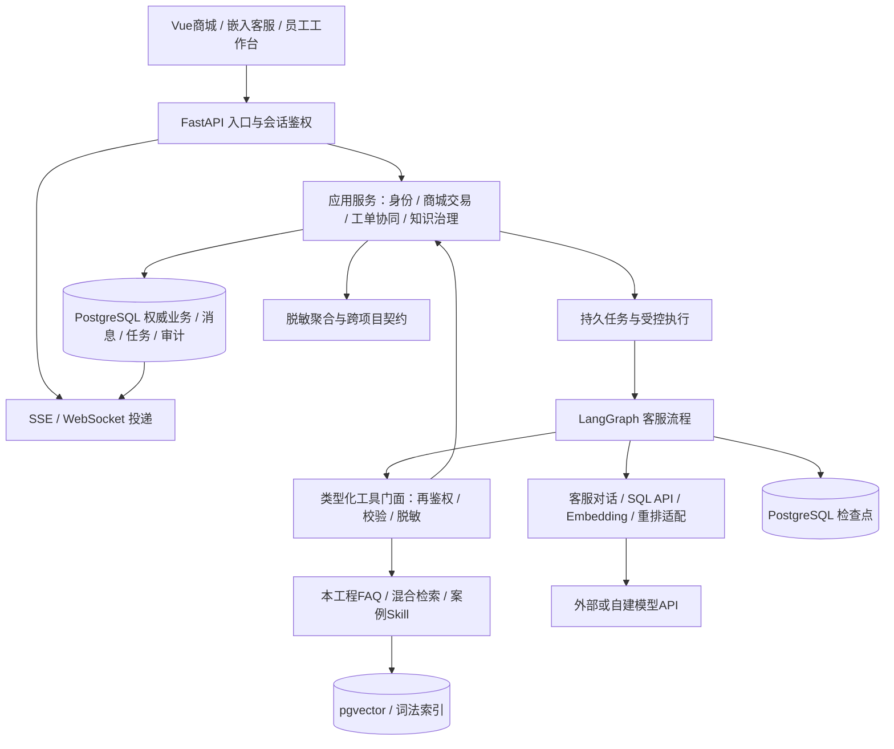

# 架构设计

版本：DESIGN-CS-v0.1；2026-10-22。输入REQ-CS-v0.2已批准，本项目设计也已获用户签核，见设计评审7；原建议表述按该决定采纳，具体版本和运行结果另验。本文只记逻辑设计，不生成实现或部署资产。

## 1. 目标与方案取舍

系统服务单个模拟店铺的电脑网页，用完整但受控的交易事实支撑客服。V1包含全部基线P0/P1；通过余额模拟充值/支付/退款，整单发货和本人确认收货，支持按明细数量退货。优先解决身份/数据范围、并发写入、事实证据、会话恢复及人工竞争，避免支付平台、微服务和知识导入平台扩大范围。

| 方案 | 适用收益 | 代价与决定 |
| --- | --- | --- |
| A：模块化单体＋PostgreSQL，API/任务执行职责可分进程 | 交易相关事实可在同一事务收敛；保留模块接口、可独立测试；符合10并发参考规模 | 建议采用。需约束模块依赖、数据库连接和持久任务，不把“单体”当成一个巨大模块 |
| B：业务、Agent、知识、消息拆为独立服务 | 便于多团队独立扩缩和部署 | 需要跨服务鉴权、分布式写入/消息及运维，当前无需求收益；不作为V1默认 |
| C：仅内存对话＋前端模拟订单/余额 | 初始演示工作量少 | 不满足权威记录、重复扣/退、恢复和人工接管验收，排除 |

选A不承诺单进程内存可靠性。进程重启后，订单/流水/消息/任务仍在数据库；Redis/MQ/任务框架可在需求增长时再评，不是FAQ或实时通信的前置条件。

## 2. 逻辑结构与依赖方向

图中数据库可属于同一PostgreSQL实例，业务、模型检索、检查点和运行审计使用隔离的访问面；不要求各建一套服务器。模型服务地址独立可配，模型不直连数据库。只允许工具调用应用服务，业务服务不回调模型、不依赖LangGraph内部状态。

| 模块 | 输入/输出与职责 | 禁止承担 |
| --- | --- | --- |
| identity | 可信会话→主体、店铺、角色、会话状态、授权版本 | 从模型参数/订单号推断顾客身份 |
| catalog/inventory | 商品/SKU事实、报价、预留/释放/扣减及店铺维护 | 从知识答案或02候选方案修改现价 |
| commerce/wallet | 本人订单、确认、付款/充值/退款、改址、发货/确认收货和账务一致性 | 任意写SQL、员工直接编辑余额 |
| service_case | 售后/运输异常、人工审核、收退/责任核验、例外依据及可退量额 | 仅凭Agent解释批准售后或提前到账 |
| support | 工单、分派、投诉、队列、人工接管和结束 | 把连接断开当释放接管或关闭工单 |
| conversation/runtime | 消息顺序、任务/确认、中断、模式代次、恢复与投递游标 | 用检查点覆盖订单或余额 |
| knowledge/experience | 受控文本、FAQ、检索来源、案例/Skill治理、版本和失效 | 完整文件平台、自动修改权限/代码 |
| model_gateway | 四类服务能力、协议适配、预算、错误/版本/脱敏轨迹 | 拥有数据库凭据或自行批准工具 |
| feedback/contracts | 去重反馈、聚合、事件、消费/版本状态 | 输出订单/会话明细给02 |

模块名是职责命名，不是已创建的代码包。共享内容限ID、时间/金额类型、错误与权限上下文；禁止以“公共工具”绕过业务服务直接改其他模块记录。

## 3. 技术配套与接口边界

| 能力 | 本设计建议 | 理由与验证门槛 |
| --- | --- | --- |
| 前端导航/共享状态/组件 | Vue Router、Pinia、Element Plus | 路由分商城/本人/员工/知识页面；跨页仅保存登录摘要、当前会话/购物车视图；组件支撑桌面表单表格。按Chrome/Edge、焦点/键盘及类型检查验证，未锁具体版本 |
| 后端契约 | FastAPI＋请求/响应类型校验 | 路由仅做身份/输入与调用边界；同一应用服务供页面和Agent工具调用，避免两套规则 |
| 数据访问 | SQLAlchemy 2系列能力面；每请求/任务独立事务会话 | 模块内仓储和显式事务，模型调用期间不占用业务锁或长事务；真实兼容版本后续锁定 |
| 结构演进 | Alembic | 管理后续迁移链和版本；自动生成只作候选，RLS/视图/数据修补人工审查；当前不生成迁移 |
| Agent恢复 | PostgreSQL检查点＋独立持久任务/确认/业务结果 | 检查点恢复图进度，任务租约控制运行，权威事实回查；三者不能互相代替 |
| 中文词法/SQL语法 | jieba受控词典；SQLGlot PostgreSQL AST | 填补中文词法与结构检查需要；解析成功不等于安全，需独立授权/数据库防线，详见Agent设计 |
| 实时投递 | PostgreSQL持久事件＋连接投递器，轮询兜底，可加LISTEN/NOTIFY唤醒 | 跨进程读取同一事件记录；通知不作消息正文或可靠队列；先验证10并发负载 |
| 额外设施 | Redis/MQ/Celery/独立向量数据库暂不选入 | 仅在轮询/任务吞吐和部署复杂度有证据时重新评审，不预建冗余设施 |

SQLAlchemy文档指出AsyncSession不能供并发任务共享，因此同轮多个查询也要分别管理事务上下文；Alembic自动生成需要人工检查。这两项是工具约束，不是已完成的兼容结果。[SQLAlchemy并发说明](https://docs.sqlalchemy.org/en/20/orm/extensions/asyncio.html#using-asyncsession-with-concurrent-tasks)、[Alembic候选迁移说明](https://alembic.sqlalchemy.org/en/latest/autogenerate.html)

## 4. 可信身份、授权和隐私

### 4.1 请求级与动作级约束

浏览器建议同源会话Cookie，后端保存会话及停用/过期状态；Cookie不承担业务权限。非只读HTTP请求核验CSRF，WebSocket检查Origin及首帧会话绑定；模型密钥不进浏览器。游客只有服务端签发的游客会话，可读公开内容，其历史不能由传入一个guest_id读取。

可信上下文包含subject_id、subject_type、store_id、当前会话/角色、授权版本、请求ID，完全由服务端取得。角色切换需验证该主体持有角色并留痕；参数中actor_id/customer_id不被信任。Worker恢复时检查关联会话仍有效，不把曾经登录当长期写入许可。

授权依次核对主体有效→本店→操作能力→本人或有效分派关联→资源状态→字段投影。不存在与无权个人资源统一返回可访问记录未找到；员工无分派先拒绝详情，不能通过订单号跳过。客服主管本店范围不等于任意导出和解密权；店铺管理员仅履约必要字段，知识管理员无订单/会话访问权。

### 4.2 数据库防线

业务写连接和SQL候选执行连接分离；候选只读角色不是表所有者、超级用户或BYPASSRLS角色，无DDL/DML/危险函数权限，不读取完整地址/凭据/会话原文。建议本人查询视图配合底层RLS，调用前在事务内设置可信顾客/店铺上下文；缺上下文默认拒绝，连接复用前后保证不串主体。模型不得产生用于设置上下文的语句。

模型面只暴露脱敏查询视图。视图拟采用调用者安全语义并验证底层行策略，避免视图所有者权限导致绕过；精确物理权限及视图定义在后续实施评审中逐项验证。PostgreSQL说明所有者通常绕过RLS，超级用户和BYPASSRLS始终绕过；强制RLS不能替代非特权执行角色。[RLS官方说明](https://www.postgresql.org/docs/current/ddl-rowsecurity.html)、[视图权限语义](https://www.postgresql.org/docs/current/sql-createview.html)

V1自然语言Text-to-SQL只用于顾客本人及公开业务视图；员工工作台按已分派/本店范围走固定查询服务，不为员工额外开放自由SQL。查询白名单及RLS不允许升级为本店顾客数据分析入口；02经营分析使用其自身评审契约。

### 4.3 字段投影与敏感输入

| 访问面 | 电话/地址及内容策略 |
| --- | --- |
| 本人获准个人地址/订单页面 | 可取本人完整收货信息；使用专用响应类型和受控读取，不复用至客服工具或日志 |
| 客服/主管/店铺管理员 | 电话仅末四位，其余*；地址到市、后续*；无解密入口，不因本人个人页权限而继承 |
| 模型/Embedding/重排/SQL API/检查点/通用日志/导出 | 不含完整电话/详细地址、令牌或密钥；SQL API无订单结果集；公开知识向量不混入订单和聊天原文 |
| 例外案例/Skill | 去身份化过程、条件、核验步骤及结果类别，不能复制原个人资料、原订单凭证或旧退款结论作为当前授权 |

字段由服务端按响应类型显式选择，禁止先返回全对象再在UI遮盖。聊天自由文本在持久化、广播、追踪及外发模型前统一识别/脱敏；疑似完整收货信息但无法可靠提取时拦截外发，提示使用本人地址表单。原文仅在本次输入处理的受控内存中短暂存在，不进入通用消息/检查点；结构化完整地址直接进入受控个人业务路径。正常与变形输入、工具输出、错误栈、导出和模型上下文都要进入AC-CS-064/067/079测试，不能宣称仅用正则即可证明所有输入安全。

## 5. 前端页面与状态所有权

| 页面/状态 | 建议职责 | 服务端事实与异常 |
| --- | --- | --- |
| 商城、商品、购物车 | 公共商品和报价，多SKU结算候选 | 报价/库存变化返回新报价并重确认；本地价格/购物车状态不能确定可售和应付 |
| 我的订单/余额/地址 | 本人订单状态、一次改址标记、支付/充值/确认收货和售后入口 | 每次操作读取后端允许动作及版本；已改址灰显“地址已修改”，前端状态不可重置次数 |
| 嵌入客服 | 同一服务名称“店铺客服”，持久消息、流式阶段和待确认卡片 | 路由切换保留连接视图但按主体隔离；换账号清空本地上下文并重新鉴权，不把游客历史并入新账号 |
| 客服/主管工作台 | 脱敏队列、获分派详情、审核/回复、改派和结束人工 | 改派/撤权后原详情和推送失效；结束人工自动Agent，不能误关顾客会话 |
| 店铺与知识页面 | 已确认角色对应商品/库存/发货/收退、知识FAQ治理、案例Skill主管页 | 角色路由守卫和按钮只是交互；直接API同样鉴权，不新增完整文件平台 |

Pinia只管理确有共享需求的客户端视图，商品列表筛选可用路由参数、表单临时值留组件。余额、退款成功、发货及改址次数的权威都在后端。不可把尚未完成的流片段标成最终业务结果。[Vue Router导航守卫](https://router.vuejs.org/guide/advanced/navigation-guards.html)只提供导航控制，项目仍独立执行后端权限。

## 6. 任务、投递与人工竞争

POST消息先在短事务内保存顾客消息、run和待执行任务，再返回持久接收确认；浏览器断流不取消run。任务执行器取得带期限的租约/栅栏版本，每会话同一时刻只有一个获准执行主体；提交时在短事务内锁定并核验最新栅栏，旧代次不能继续写入或发消息。每个业务动作通过原operation_id回查结果，不能由重跑节点创建新的充值/退款意图。任务/会话/分派/业务对象的统一锁顺序见数据设计5，模型等待期间不持锁。

会话具有mode=agent/queued/human和递增mode_epoch。进入排队就暂停Agent新回答/动作；接管/结束在会话锁下更新模式和代次。所有Agent可见输出与会话来源动作在提交前检查run绑定epoch，持久事件与模式检查处于同一提交边界。若业务写先取得会话门槛锁并成功，接管随后发生，保留该成功结果；若排队/接管先提交，旧Agent写入被拒绝。已入队前的合法片段保留历史，迟到片段不追加为当前答复。

人工断线保留接管；结束服务由有权员工显式操作，自动切回Agent并撤销旧待确认卡片的执行资格。新诉求启动新run；若要继续旧意图，重新读取事实/确认，不自动恢复旧写动作。用户“取消任务”是独立命令，只能停止尚未提交的步骤，不能回滚已成功扣款或取代取消订单流程。

投递从持久事件流按游标读取，API进程仅维护自己的连接；跨进程靠数据库事件和补偿，不能依靠共享Python列表。可选NOTIFY只携带无敏感正文的唤醒标识，断开或漏通知后轮询补齐；数据库通知不承诺离线消息保存。FastAPI内存连接管理示例受单进程限制，PostgreSQL通知的监听机制也不替代事件表。[FastAPI说明](https://fastapi.tiangolo.com/advanced/websockets/)、[NOTIFY说明](https://www.postgresql.org/docs/current/sql-notify.html)

## 7. 观测、容量与故障边界

入口、模型阶段、工具、业务事务和事件投递使用关联ID追踪，只记必要脱敏摘要、版本、耗时、错误分类。审计须在关键写事务中留下可恢复记录，再异步投递一般日志，日志平台失败不能假报业务失败后再次扣款。聚合数据按消息/工单业务ID去重，5以下主题抑制保持标记。

容量与质量沿用NFR-CS-001～014，不在设计中降低：10并发、500订单/50SKU/200知识片段参考数据，RAG70+30、SQL80+40、多轮30、账务交错至少20。对话、SQL、向量、重排分别设并发和超时预算；模型失败可转工单或降级，但需记录，不能把外部慢请求排除后宣称达标。

故障注入覆盖数据库提交后响应丢失、检查点落后、任务租约过期、权限/分派撤销、乱序重复事件、跨进程断线、模型超时和重排协议错。可用率、恢复时限、P95及质量只有真实环境证据才能判定。设计不选择机器规格、不生成进程/容器配置，资源及兼容验证见[设计评审记录](设计评审记录.md)。
