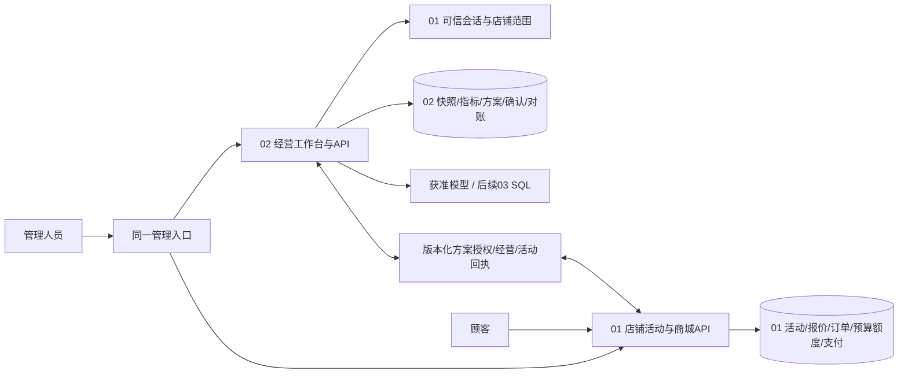

# V1完整运营方案与店铺活动闭环设计

版本：DESIGN-OPS-v0.1｜2026-10-23｜**用户已批准，02已实施；01待用户协调与双方联调**。

输入：[REQ-OPS-v0.2](../01-requirements/PRD.md)。用户已批准首发现货直降及完整方案/真实执行闭环，明确“01由我协调，本会话仅实施02”。批准不代替01契约签收、真实集成验收、模型费用或部署授权。02实现差异见[模块验收](../06-acceptance/02模块验收记录.md)，字段/路径见[实际契约](../04-integration/02实际执行契约.md)。以下设计原则保留为双方验收目标。

## 1. 交付结果与首发范围

V1出口是：管理员一次登录，在经营工作台提出目标；02基于经营快照生成候选，编制含资源、执行责任和监控条件的完整方案；所有必需检查通过后，店长确认，再明确点击“发布活动”；01在店铺系统持久发布，顾客看到活动价、结算和订单使用同一优惠，预算/数量不超占；管理员能暂停/结束；真实活动实际回到02监控复盘。

首发建议限定：CNY、获准店铺、选定SKU的独立直降、现货不补货、无叠券/跨店、无采购/广告依赖；每SKU保存确定的活动单价和活动数量上限。可包含多个SKU，但每SKU规则独立，同SKU重叠活动拒绝。客服/仓储用已确认的岗位容量参数检查，不提前建设个人排班系统。满额券保留探索测算，执行不支持时不能进入可发布集。

独立测算、合同替身、演示按钮都是中间产物。V1签收需要真实01/02接口、数据库和商城购买流程；模拟店铺的数据仍标synthetic，不承诺促销实际增量。

## 2. 架构选择与职责

| 方案 | 取舍 | 选择 |
| --- | --- | --- |
| 同一产品入口，01与02按API分开维护 | 复用01身份、商城与执行事实，02独立维护经营数据/方案；需要身份/活动/经营契约签收 | 推荐；符合三个目录及当前事实 |
| 将01整仓复制到02再扩展 | 两套身份、订单/库存和回归容易分叉，活动实际难以统一 | 不采用 |
| 02单独看板＋模拟发布 | 初期规则验证便捷，无法证明店铺执行效果 | 仅测试适配器，不作为V1产品 |

建议Vue/TypeScript承载02工作台、FastAPI承载业务API、PostgreSQL承载02数据与持久任务；与01技术生态保持兼容，最终依赖版本在实施前锁定。02依赖已安装并锁定，当前版本见requirements.lock/package-lock.json；真实PG与01集成仍待验收。首版不引入Redis、独立消息队列、向量库或多Agent层。数据库持久任务/Outbox满足当前状态与重试；模型适配器与业务服务分开。

01拥有活动状态、报价、订单、库存、预占/核销、支付/退款与执行回执；02拥有分析目标、来源快照、计算、完整方案、决策和监控视图；03只生成SQL候选/训练评测，不获得数据库执行权。02不读取01物理库或持有01写连接，模型不能调用活动写工具。

## 3. 统一管理入口与身份

建议统一站点下 `/shop` 保留01业务管理，`/operations`承载02工作台，管理导航增加“经营分析”“店铺活动”；既有 `/api/v1/`路由到01，新 `/api/ops/v1/`到02。具体入口配置归总体协调，本文不改根目录或01。可以是两个前端构建，不要求复制或合并整个工程。

现有事实：01用HttpOnly/SameSite=Strict的cs_session Cookie，POST/DELETE/PATCH校验Origin与X-CSRF-Token；GET `/api/v1/session`返回subject_id/store_id/active_role/roles/auth_version/expires_at/csrf_token。frontend request使用same-origin。01不是已交付的通用SSO，也没有天然operations角色或跨店列表。

设计消费方式：02仅向配置白名单内的01会话地址转交指定cs_session Cookie进行身份校验，不保存密码、不解析或复制01会话签名算法、不将Cookie交模型/日志；禁跟随重定向。每个敏感读/写、任务恢复、下载和决策重新核验，不用正向权限缓存满足撤权。01不可用时失败关闭。返回字段限白名单，不导出个人身份细节。

02定义经营能力metrics.read、cost.read、data.import、plan.edit、plan.confirm，但在线能力授予/撤销以01的主体/店铺/capability_revision为单一权威；02只保存投影/审计，不建立另一套可独立扩权的授权主库。activity.publish/manage同由01实施，并与已确认计划绑定；shop_admin名字不自动附成本/发布权。发布事务重新锁定核验01当前主体/能力版本，撤权不能仅靠02缓存传播。初版只开放当前会话获准店铺；多店登录能力另审。02写API校验本站Origin及可信会话绑定CSRF，向01写入仍由01鉴权/CSRF。01现有session尚无该能力投影，须DEP-06/07签收新增字段/管理方式。

开发测试可注入固定身份适配器，仅在隔离测试配置启用；生产配置禁止该适配器，也不接受X-User/X-Store等客户端自报身份。测试登录/页面通过不算统一登录通过。

## 4. 管理人员页面与操作

| 区域 | 核心内容 | 动作与门禁 |
| --- | --- | --- |
| 经营工作台 | 支付/退款/净实付、销量/库存/成本覆盖、数据时点；Agent问题区 | 看状态、追问、建立活动目标；利润未知时显示缺口 |
| 方案详情 | 目标、候选比较、资源/责任任务、执行规则、监控与停止条件、证据 | 修改草稿、重算、提交、确认/驳回；未知硬约束不确认 |
| 店铺活动 | 完整执行方案、原价/活动价、SKU/额度、起止、执行状态/记录 | 预检、发布、暂停、恢复、提前结束；执行权单独校验 |
| 监控/复盘 | 01实际支付/退款/数量/让利、计划差异、库存/预算余量、watermark | 查看风险、提出调整；调整产生新方案/审批，不让模型直接改正在运行的活动 |

确认方案与发布活动是两个动作。发布前展示将生效的价格、数量/让利上限、时间及对旧报价/订单的影响；按快照计算过不代表最新预检通过。按钮必须关联真实API和回执，网络超时显示“结果待核对”，不能提示未发布并新建另一活动。

## 5. 02内部模块与主要数据

下列是拟新增职责/实体，不声称文件或表已经存在；物理迁移只在实现阶段创建和执行。

| 模块 | 主要职责/拟实体 | 不变量 |
| --- | --- | --- |
| identity | 01身份适配、能力只读投影/审计、字段投影 | 在线授权权威在01，02不独立扩权；每次恢复复核 |
| snapshots | data_batch、snapshot_revision、source_mapping、成本/费用/容量来源 | 不可变批次、源修订替换、保留synthetic来源链 |
| metrics | 指标字典、固定只读查询、结果query_ref | 支付/退款粒度先聚合，口径与分母绑定；空/0/未知分开 |
| simulation | 候选/情景、Decimal/整数分测算、约束结果 | 模型不算钱；同输入/版本结果一致 |
| plans | goal、plan_version、validation_result、task_checklist、approval | 方案不可变版本，金额/资源/执行三类校验，审批不覆盖历史 |
| execution_bridge | execution_intent、grant、receipt、outbox/inbox、reconcile_attempt | 一个审批版本至多一个意图、grant和01活动；01才是执行权威；未知结果先终态对账 |
| monitoring | activity_snapshot_revision、metric_comparison、alert、retrospective | 经营实际与客服周证据分开，按revision替换，不把ACK当实际 |
| agent | 问题/槽位、工具路由、结构化解释、持久任务 | 无发布/支付工具；有界请求、费用未授权不真实调用 |

02自用数据库与01分离，迁移角色、应用角色、只读查询角色分开。金额用BIGINT分、跨服务字符串；比例用定点，未知值用NULL与原因。所有业务实体带store_id、来源/批次、version、created_at/updated_at；跨表引用校验相同store。唯一键至少包括源批次摘要、(store,plan_id,version)、执行意图号、消费event_id、(snapshot_id,revision)。

成本/容量缺失不补0。V1模拟数据可以提供有标记的完整成本与岗位参数；若使用实际源则核验字段覆盖和负责人的确认记录。分析接口先读取02已签收快照，03后续仅对02允许的经营只读投影生成候选，不能去01写库查全表。

## 6. 完整方案的生成与状态

方案必须包含：目标/SKU/活动窗；数据证据/假设；原价与候选对比；选定价格/数量/让利预算；商品成本、贡献利润及范围；库存/履约/岗位容量；执行任务的负责人/截止/依赖/完成条件；活动发布/暂停/结束清单；监控阈值/数据源/复盘时间；版本与审批记录。

方案状态建议：draft → evaluated → ready_for_confirmation → confirmed_feasible；不通过可为needs_data/infeasible；另有rejected/invalidated/archived。validation_scope记录已检查哪些范围，validation_result分经营、资源、执行、任务完整度。只算利润通过的候选仍为evaluated，不提升为完整可行。

数据/预算/成本/资源/规则/活动能力改变必须重算并重新确认。确认前缺执行支持不能通过；如果01实际预检晚于方案确认发现资源变化，进入invalidated/needs_data，不跳过预检。确认绑定原始不可变版本，新的编辑只生成新草稿。

**执行状态独立**：not_requested → prepared → publishing → published；异常为result_unknown/failed，published之后回映01的scheduled/active/paused/ended。01未实际持久提交，02不能显示已发布。活动暂停/结束不会抹掉旧决策或改旧订单。

## 7. 发布协议与未知结果

为避免两个数据库假装原子事务，采用“不可变方案授权＋01本地事务＋回执/对账”。接口详见 [跨项目接口与01变更单](跨项目接口与01变更单.md)。

1. 02按最终方案做资源/经营/执行检查，店长确认；01活动页通过服务身份取得受控方案，不信任前端传来的金额或确认人。
2. 用户点击预检，01按最新本地SKU/价格/库存/冲突/权限返回preview_ref、绑定的计划摘要/资源版本、有效期和检查结果。没有活动/事实契约时不伪造通过。
3. 用户明确发布；01再验会话/执行权/CSRF及预检，在短事务持久创建execution_slot，以(store_id,plan_ref,plan_version,approval_ref)唯一，服务器生成intent。两个客户端/不同幂等键命中同一槽位；02同样以审批版本唯一授予grant（绑定该intent、actor/store、版本/规则/期限），记录publishing并冻结原意图。网络调用在事务外。
4. 在授权期限内，01本地短事务按“主体/能力→execution_slot→商品/SKU→库存/活动额度”的统一次序锁定；校验当前能力、slot非终态、版本/时间/冲突/摘要。在槽位临界区内接受有效grant后，可完成该次本地事务，插入唯一审批/slot/grant对应活动及固定预算占用、规则快照和Outbox；同事务将slot标committed。事务内不调用02/模型。
5. 01提交后返回activity_id/version与operation_ref，02消费回执并对账；响应丢失时按grant/intent查询01原结果，不能换键再发布。

grant建议有效60秒（待评审），到期后不能新进入槽位临界区受理；已持槽位锁且在到期前受理的事务可以完成，最终结果由持久slot判定，不以HTTP到达时间猜测。preview建议5分钟，资源版本变化立即失效。

**终态屏障：** 01新增finalize-expired对账写操作；授权到期后，锁同一个execution_slot并在取得锁后读取可信当前时钟。若发布事务在途，该操作等待它提交/回滚；等待超时返回unknown。若slot已committed，返回原activity；否则在锁内写closed_no_effect/terminal_revision，后续任何迟到发布必须锁slot并拒绝。只有这个已持久封闭的状态才能返回absent_after_expiry；只读GET查不到活动/slot、超时或授权到期都不能解除02冻结。服务崩溃回滚后也按此闭合。旧grant/slot关闭后不能重新打开。

**审批次数：** 一个approval_ref＋plan_version只可产生一个intent/grant和活动。结束活动后仍不允许复用审批再发布；失败终态后重试同意图只能回原失败。需要重新执行时产生新方案版本和人工审批，展示旧已核销/未付预占，明确新增预算或在原总预算扣除旧占用，不能原封复制完整预算偷偷续发。

**冻结边界：** grant签发前，成本/数据/任务/审批变化都要重算。签发后，经营快照/成本/情景作为已批准的短期执行假设冻结；新数据标记待重评，但不能在02单方面宣布在途授权已失效。01侧实时权限/capability_revision、价格、可售、库存、额度、活动状态仍在发布临界区重新校验，变化即拒绝。若要撤销审批或紧急停止未决意图，02发cancel-request，由01在同一slot屏障闭合：未提交则closed_no_effect，已提交则返回活动并要求有权人员暂停/结束；不能承诺跨数据库瞬时撤销。新方案不得绕过未决旧意图。此规则是有期限的快照授权，不宣称所有经营数据始终为最新。

不通过“发送成功”证明生效，不补造activity_id。01实际结束与02回映短暂不一致时以01为准，02显示最后核对时间/待核对。回执至少一次，02按event_id去重并按activity_id/version替换；未采用消息平台，先用数据库Outbox＋有界拉取/重试。

## 8. 01活动价格、预算与订单（必需变更）

### 8.1 活动叠加于常规价

推荐新增01活动域，不直接把SKU常规售价改成活动价。活动保存SKU、确认时原价/price_version、活动单价、[start,end)、活动数量上限、预算上限/固定费预算占用、方案/规则/授权版本。锁同一SKU后检查时间窗重叠；不依赖新中间件或定时器保证排他。

01唯一价格解析用于商品页、购物车显示、quote与create_order校验：按可信时钟、状态和额度识别可用活动；活动单价优于原价且来源可追溯。首版有未结束活动时，常规售价变更返回冲突，需先结束活动再改价；上下架/库存变化仍须检查可售。结束后自然回到当时有效常规价，不执行“写回旧价”。

报价保存base/effective unit price、activity_id/revision、规则/窗口、SKU价格版本及优惠行分摊；旧有goods_minor是优惠前商品金额、discount_minor为真实优惠、allocated_minor为实收。01现有ALLOC-LAST-UNIT-v1历史订单不重写；新直降整数单价不产生单位分摊余差。方案的订单级权重分摊只用于已有/未来订单券，不硬套进旧退款分配规则。

### 8.2 时间、预占与预算

活动“是否生效”按每次请求的可信时钟判断，开始含/结束不含；显示状态可派生scheduled/active/ended，Worker延迟不能延长优惠。暂停/提前结束递增活动版本，阻止新活动报价/建单，暂停前未建单报价要求重新确认；已创建订单继续按保存价与原付款有效期处理。

报价只试算；建单时活动数量/让利与现有库存同事务预占。每SKU活动数量和全活动可变让利的reserved＋consumed不得超过上限；可变让利上限=方案总让利预算－固定费预算占用。固定费预算占用不是自动扣现金，实际支付费用另外导入。并发争抢失败返回重新报价，不静默按原价扣款。

付款将活动预占核销，未付款取消/到期与库存释放一起释放一次；付款后退款按原订单已分摊实付进行，不恢复活动营销额度（保守上限，防循环购买）。计划预算、预算预占、已核销让利、现金费用、会计利润分开列。订单行保留活动归属，退款沿原行/原活动归属，不能按活动后新价退款。

统一锁顺序须覆盖发布/恢复、SKU常规改价、quote校验/建单、支付、取消到期和退款的活动/库存行；实施前由01对现有锁顺序增量评审，不能只给新发布接口加锁。预算任何异常失败关闭，禁止用全价静默替换顾客已确认价。

## 9. 实际经营、监控与Agent边界

01新增面向02的只读经营/活动聚合；包含store/activity/SKU/time bucket、支付/退款事件口径、销量/退货分开、预占/核销预算、库存时点、watermark、source_kind和版本。02保留完整度与迟到修订，真实业务事实不从客服周汇总推算。

V1基础监控可用受控分桶拉取/导出：有真实01执行与真实实际输入，频率目标待D-04签收；如果只有回放就明示回放，不能签实时目标。风险由确定性阈值触发、Agent解释；暂停/结束仍由管理员有权点击。自动停活动仅限01确定性时间/数量/预算硬门禁，不由模型自由决定。

Agent可用工具：读取获准指标/证据、运行情景测算、计算资源容量、编制草稿/任务清单、读取校验结果。确认/授权grant/活动写接口不在模型工具表。结构化输出必须实际Schema校验，引用每个工具结果与快照；缺字段不补身份、SQL、价格或利润。03接口未就绪可固定工具先开发；真实模型费用与型号未授权不调用。

## 10. 验证、开销与批次出口

| 批次 | 工作与证据 | 能宣称完成什么 |
| --- | --- | --- |
| B0 设计/契约 | 增量需求、身份/经营/活动共同样本、01改动签收 | 可进入实现，不是业务完成 |
| B1 02确定性内核 | 快照、指标、金样本、约束、容量/任务完整度、版本和权限 | 规则层/完整方案，不是活动已生效 |
| B2 01执行域 | 实际活动/价格统一解析/额度/报价/订单/取消退款，既有交易回归 | 模拟店铺实际执行能力，不是02真实集成 |
| B3 统一工作台与集成 | 同一登录、计划确认、真实预检/发布/回执、商品优惠购买、暂停/结束、实际汇总/复盘 | 满足全部V1AC后提交用户签收 |
| B4 有界模型与交付 | 固定小集、费用/首次失败、真实负载、恢复/部署检查 | 仅对应证据范围；部署另需环境/目标确认 |

报价/建单关键路径只访问01本地数据库，不能等待02/LLM；活动过期由时钟判断，不轮询模型。参考开销目标：同硬件/数据/负载，相对无活动基线P95新增≤50ms（待评审），观测锁等待/查询数、CPU/RAM与费用。02继续PRD的3秒确定性目标；错误/超时不能剔出分母。无事件量证据不提前加MQ/缓存；如需缓存，失效必须覆盖价格/活动版本和时间边界。

测试优先覆盖AC-OPS-049～060及金额/权限/幂等/越权/旧订单退款回归；金样本D在真实quote→order→pay链路核对，不能仅检查UI成功文案。首个失败保留，不重跑模型掩盖协议问题。发布/支付对账与迁移回滚各自留证；撤回新入口不抹已发活动，停止活动/处理预占后再做数据兼容回滚。

## 11. 评审范围与当前限制

本版推荐“完整方案＋首发直降执行”，统一管理体验已获用户同意；具体首发规则、活动额度/旧订单/预算口径与接口、01修改范围仍待本轮评审。原“只改02、兄弟只读”仍有效：本文件提出01影响，未写01。没有真实数据/业务库/模型/HTTP验证，没有可运行V1或执行按钮。

用户不需逐文件确认。评审应一次确认设计版本、执行范围和是否由本会话修改01或由01会话接变更单；获批后按批次完成授权工作。关键未决见 [设计评审记录](设计评审记录.md)，本轮截止设计材料。
